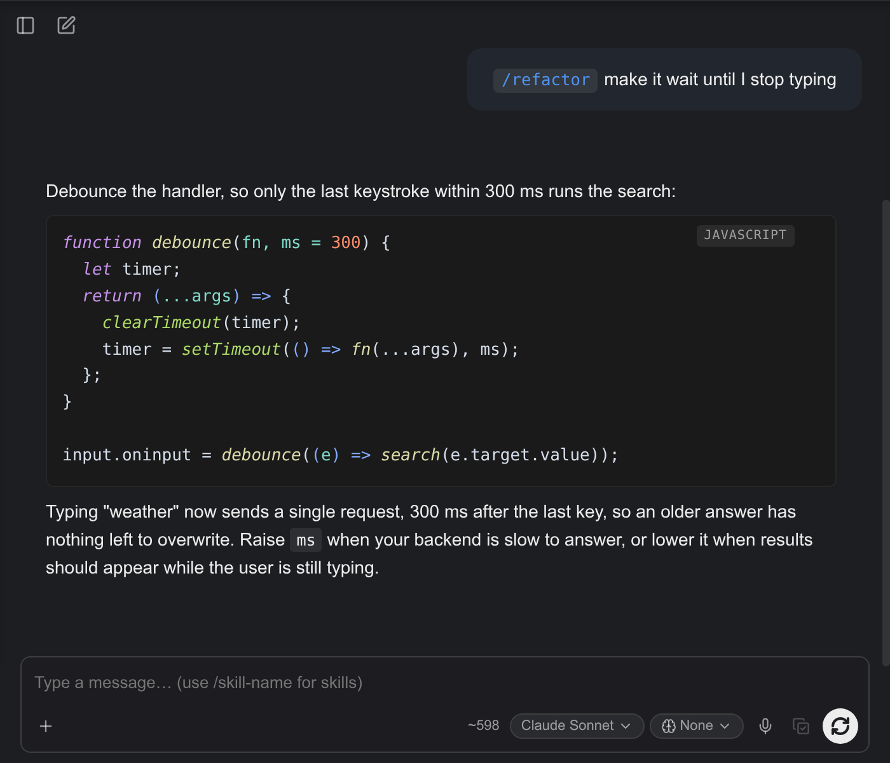
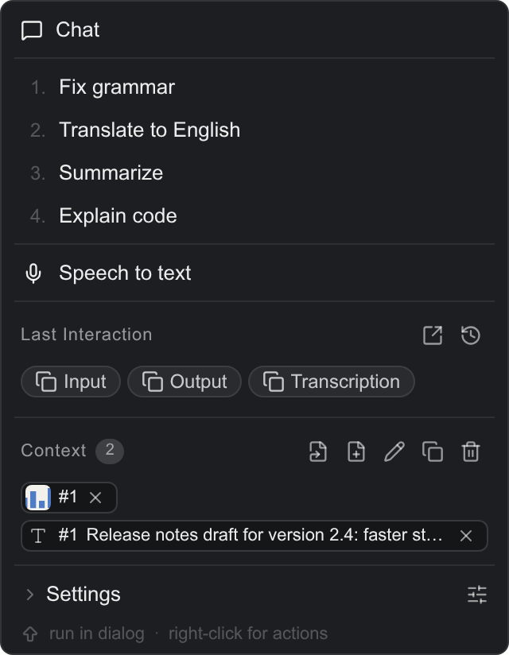
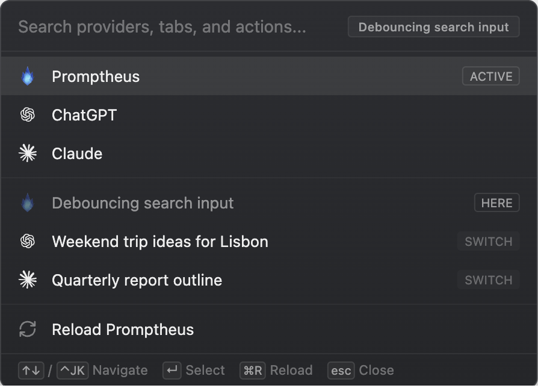
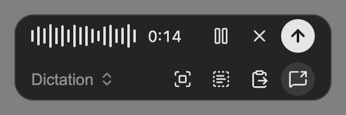
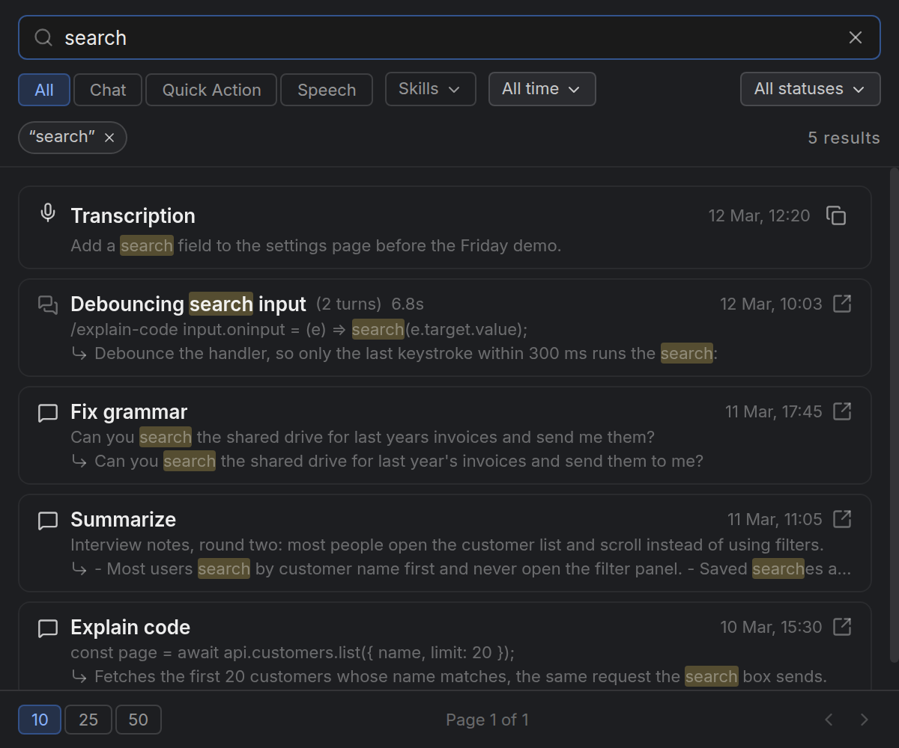
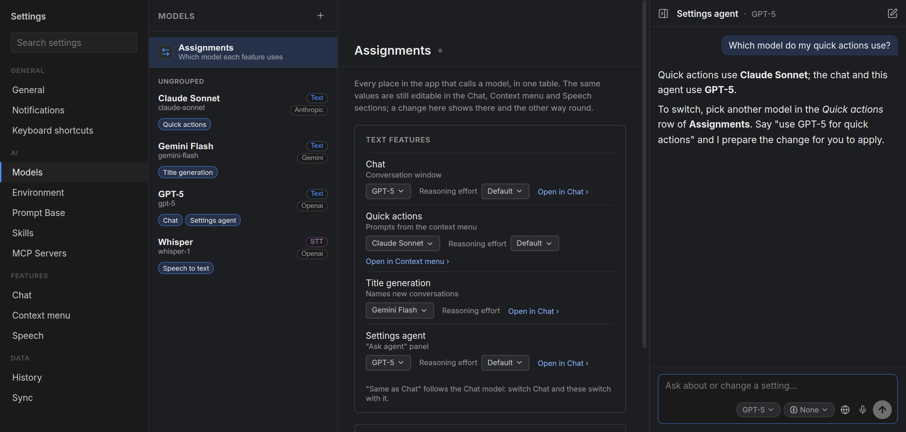
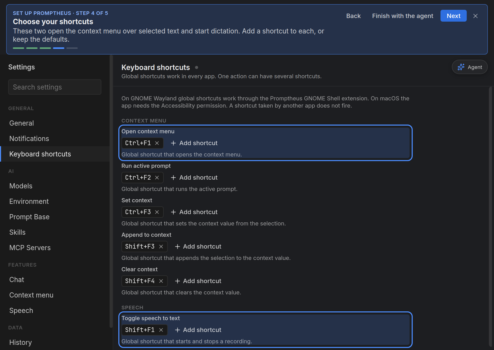

# Promptheus

A tray-resident AI prompt launcher for Linux and macOS: a global hotkey opens a context menu of your prompts over the selected text, next to a streaming LLM chat, speech-to-text dictation with a recording pill, MCP tools, ChatGPT and Claude web apps in tabs, and searchable history.

<p align="center">
  
</p>

Promptheus lives in the system tray and stays out of the way until you press a shortcut. Select text in any app, press the global hotkey, pick a prompt, and the answer lands on your clipboard or in a chat window. Built with Tauri 2, Svelte 5 and Rust. Pre-1.0.

## What it does

### Context menu over any app



The global hotkey (`Ctrl+F1` on Linux, `Cmd+F1` on macOS by default) opens the context menu at the pointer, over whatever app has focus. Each prompt (skill) runs on the clipboard text and writes the result back to the clipboard; with `Shift` it opens in the chat window instead. Digits pick a prompt, so a quick action is two keystrokes.

The menu also keeps a context: snippets and images collected with the "Set context" and "Append to context" shortcuts, sent along with the next prompt. "Last interaction" copies the input, output or transcription of the previous run.

Prompts are Markdown files with `{{placeholder}}` variables, edited in Settings → Prompt Base and Skills.

<br clear="right">

### Streaming chat

The chat window streams answers from any model you configure: the OpenAI Responses or Chat Completions API, or any OpenAI-compatible endpoint (vLLM, MiniMax, local servers). Type `/skill-name` to start from a prompt, attach files and images, dictate with the microphone button, switch model and reasoning effort per message. Code blocks are highlighted and Mermaid diagrams render inline. Conversations get titles and are stored in history.

### Command palette and AI provider webviews



The chat window also hosts the web apps of AI providers, such as ChatGPT and Claude, each in its own tab with your own login. `Cmd/Ctrl+P` opens the command palette: switch providers, jump to an open tab or conversation, reload. Providers are a name and a URL in Settings → Chat.

<br clear="right">

### Speech-to-text dictation

<p>
  
</p>

`Shift+F1` starts and stops a recording anywhere. The recording pill shows the waveform and timer, pauses or cancels, and picks where the transcript goes: plain dictation copied to the clipboard, a prompt that runs on it, the chat, or the ChatGPT or Claude tab (or Claude Desktop). Transcription uses OpenAI Whisper or ElevenLabs; a failed transcription keeps the audio for a retry. On GNOME Wayland the pill is drawn by the bundled GNOME Shell extension.

### History with full-text search

<p>
  
</p>

Every chat, quick action and transcription is stored locally in SQLite. The history window searches all of it with full-text search, filters by kind, skill, time and status, and reopens a conversation in the chat window.

### Settings and the settings agent

<p>
  
</p>

The settings window covers models and their assignments to chat, quick actions, titles and speech, API keys and environment variables, prompts, skills, MCP servers, the context menu, speech and keyboard shortcuts, with search over every setting. The settings agent next to it answers questions about your setup and prepares changes that you review and apply; each applied change is listed in the change history and can be undone.

### MCP tools

Promptheus is an MCP (Model Context Protocol) client. Add MCP servers in Settings → MCP Servers (command, arguments, environment); their tools become available to the chat and to the settings agent, enabled per tool.

## Install

No public binaries yet: build from source. Install [Node.js ≥ 20](https://nodejs.org), [pnpm ≥ 9](https://pnpm.io/installation), [Rust stable](https://www.rust-lang.org/tools/install) and the system dependencies below, then:

```bash
git clone https://github.com/filip-cudny/promptheus.git
cd promptheus
pnpm install
pnpm tauri dev
```

The first run compiles the Rust backend (a few minutes); later runs are incremental.

<details>
<summary>System dependencies</summary>

### macOS

```bash
xcode-select --install
```

### Linux (Debian / Ubuntu)

```bash
sudo apt update
sudo apt install -y \
  build-essential curl wget file \
  libssl-dev libgtk-3-dev libayatana-appindicator3-dev \
  librsvg2-dev libwebkit2gtk-4.1-dev \
  libjavascriptcoregtk-4.1-dev libsoup-3.0-dev libasound2-dev
```

### Linux (Fedora)

```bash
sudo dnf install -y \
  gcc-c++ openssl-devel gtk3-devel \
  libappindicator-gtk3-devel librsvg2-devel \
  webkit2gtk4.1-devel javascriptcoregtk4.1-devel libsoup3-devel alsa-lib-devel
```

### Linux (Arch)

```bash
sudo pacman -S --needed \
  base-devel openssl gtk3 libappindicator-gtk3 \
  librsvg webkit2gtk-4.1 libsoup3 alsa-lib
```

</details>

To build a local package:

- `pnpm bundle:linux` builds a `.deb` that also installs the GNOME Shell extension; it lands in `src-tauri/target/release/bundle/deb/`, or under the cargo `target-dir` when one is configured.
- `pnpm bundle:mac` builds a `.app` under `src-tauri/target/release/bundle/`.

Platform notes:

- **GNOME Wayland**: global shortcuts, menu placement and the recording pill need the GNOME Shell extension. The `.deb` installs it; from source, run `linux/gnome-shell-extension/install-dev.sh`. Then log out and in, and run `gnome-extensions enable promptheus@promptheus.desktop`.
- **macOS**: two features need the Accessibility permission for the app: adding text selected in another app to the recording pill, and sending a transcript to Claude Desktop.

## First run

<p>
  
</p>

A fresh install starts without models. The settings window opens with a setup banner that walks through five steps:

1. **Bring your settings from a git repository** (optional): connect the repository that holds your settings from another machine.
2. **Add a text model**: pick a provider, paste its API key and test it. When synced settings already brought the models, this step asks only for the API key, since keys are not synced.
3. **Add a speech model** (optional): the model for dictation, tested the same way.
4. **Choose your shortcuts**: the context menu and dictation shortcuts; keep the defaults or add your own.
5. **You're set**: select text in any app and press the context menu shortcut.

From step 3 on, "Finish with the agent" hands the remaining setup to the settings agent. The banner can be hidden at any time.

## Configuration

Bundle identifier: `com.promptheus.desktop`. Settings, prompts, skills and local data live in the platform-standard config directory for that ID:

| Platform | Config directory |
|----------|------------------|
| macOS    | `~/Library/Application Support/com.promptheus.desktop/` |
| Linux    | `~/.config/com.promptheus.desktop/` |

`settings.json`, `prompts/` and `skills/` hold your configuration; the app reloads `settings.json` when it changes on disk. Conversation history (`history.db`), window state and `.env` stay local.

API keys are read from `<config directory>/.env` first; then a `.env` found in the working directory or any parent (in development, the repository root) is loaded and overrides it. A model's API key can be a `${NAME}` reference to such a variable, managed in Settings → Environment.

### Sync settings between machines

The repository is optional: without it the app keeps everything in the config directory. Connect one when you want, for example, the same settings on several machines.

Settings → Sync keeps `settings.json`, `prompts/` and `skills/` in a git repository of your own. Connect a remote URL or a local clone, choose a folder in it and what to sync: the entries move into that folder and the config directory links to them. The app then fetches, commits, rebases and pushes at startup, every 5 minutes and on "Sync now"; on a conflict it pauses until you resolve it in the repository. API keys (`.env`), window state, conversation history and logs are never synced. Git must reach the remote without a prompt (an SSH key in ssh-agent, or a credential helper for HTTPS).

## Development

Commands, code style and recurring platform gotchas are in [`CLAUDE.md`](CLAUDE.md); the per-directory documentation index is [`DOCS.md`](DOCS.md). The screenshots above are rendered from invented data by `pnpm screenshots`, see [`scripts/screenshots/DOCS.md`](scripts/screenshots/DOCS.md).

## License

MIT, see [LICENSE](LICENSE).
